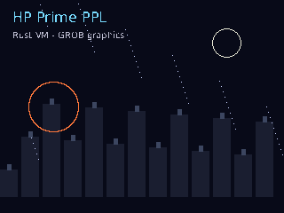

# HP Prime Emulator

[](https://github.com/golba98/hp-prime-emulator/actions/workflows/rust.yml)
[](LICENSE)

Write, check, debug, and run HP Prime PPL programs on your desktop. The project includes a graphical editor, a native Rust execution engine, and a CLI for working with programs and a connected calculator.

The native engine runs without a calculator or firmware files. An optional Linux backend runs separately supplied HP Prime G1 firmware. This is an independent project and is not affiliated with HP.



## Build and open the GUI

Install stable Rust with Cargo, your platform's C/C++ build tools, and HID development dependencies. Linux builds need `pkg-config` and `libudev` development files. The GUI needs a graphical desktop session.

From the repository directory:

```bash
cargo build --release --bin ppl
cargo run --release --bin ppl -- gui
```

This opens the desktop IDE. To open an existing program:

```bash
cargo run --release --bin ppl -- gui examples/FIREWORKS.hpprgm
```

The IDE uses the native engine. It is separate from the viewer for a physical calculator.

**Full Calculator** keeps the housing, LCD and keypad together as the panel shrinks; **Expand** makes the keys larger, and **Screen Only** remains an explicit display mode. The Native calculator provides Home expression evaluation, typed Ans, separate Home/CAS histories, a program catalog populated from the current editor tabs, and local calculator app workflows. Settings, variables and calculator drafts are saved in its Native profile. App and navigation coverage remains incomplete; Native does not run the G1 firmware.

**Apps** opens a four-column Application Library for the 17 supported apps. Use the arrows or type the first letters of a name to highlight it, then press Enter or **Start**; tapping an icon opens it directly. **Sort** offers chronological, alphabetical and fixed order. The grid, selection, fonts and softkeys follow the calculator layout; icons are drawn locally and do not reproduce HP's artwork. Graph 3D, DataStreamer, custom-app Save and app Reset are unavailable.

The Function Symbolic view provides ten definition fields, **F1–F9 and F0**, with inline expression editing. **Edit** changes a definition, the check button includes or excludes it from plots and tables, **Show** displays the whole expression, and **Eval** replaces references to other definition rows with their expressions. Tap a color square and **Choose** to select a basic plot color. Definitions can reference unchecked rows, and the editor preserves the Home draft while working. Colors, selection and definitions are saved. Home and PPL can call these definitions, including through EXPR and CAS operands. Calls support numeric lists, complex numbers and calculator words converted to numbers. Qualified calls such as `Function.F1(2)` retain the caller’s app settings and app namespace inside the definition. Other graph views still use simpler layouts; custom colors, complete plot analysis tools and worksheet formulas that call Function definitions remain unfinished.

Assign a Function definition from Home or PPL with `F1:="X^2+1"` or a quoted expression; qualified assignments such as `Function.F1:=42` work from another app. Reading `F1` or `F1()` returns the definition without substituting Home X. Numeric and word literals retain their types; expressions such as `X+0` and `2+3` remain symbolic. Calling `F1(2)` evaluates the definition. PPL assignment preserves checked rows and leaves fresh rows unchecked. Assigning `""` clears the definition and its checkbox; invalid assignments retain the old definition. UI edits replace the assigned value, and definitions survive restart. Complex-pair definition text currently retains PPL tuple syntax; its exact original STRING presentation remains unfinished.

**Shift+Symb** opens Function Symbolic Setup. Choose an app-specific angle, number format or complex mode while keeping Home settings independent. The number formats include Floating and Rounded, with digit counts from 0 to 11 on the tested firmware revision. **Choose**, the dropdown arrows and keyboard navigation use the same settings; Delete restores the selected setting and Shift+Esc restores all app overrides to System.

**Num** opens the Function table with the checked definitions. Edit an X value directly, use **Go To**, or change the step with **Zoom**. **More** provides font sizes and selection controls. **Shift+Num** opens Numeric Setup; choose Automatic or Custom values, and edit the start, positive step and zoom factor. Custom rows can be inserted, deleted, sorted or swapped through a two-field dialog. These values belong to the selected app and persist independently of Home and other apps. Table inputs and results retain calculator decimal values beyond binary floating-point range. Undefined and non-real cells display **NaN**, while valid complex Function calls retain their type in Home and PPL. Overflow saturates at the signed finite calculator limit. Complete typed table copying remains unfinished.

After a Native program finishes, **Esc** with calculator focus leaves its output and returns to the view it was launched from. Home evaluates expressions using the Native PPL engine; the catalog runs the current editor revision. **Return to editor** changes the layout separately. During execution, Esc keeps its program/dialog meaning, including cancellation of INPUT and delivery to GETKEY/WAIT. **Shift+F5** explicitly stops execution. An IDE dialog owns its own Esc press. The physical keyboard and on-screen calculator keys target the local selected engine; they do not send keys to a USB calculator.

New Native profiles use the current numeric model (15751). Existing profiles retain the legacy model (15157); the IDE banner shows the selected model. Current-model history preserves supported exact integers, rational values and multiples of π behind the rounded display. Copy restores their calculator source, including decimal identity and word metadata, and these values survive restart. Numeric matrix cells use decimal values, matching the calculator.

**Shift+Home** opens Native Home Settings. Tap a field to focus it and its arrow to open the choices; Up/Down and Enter also navigate and select. The two supported pages contain angle measure, six number formats, digit grouping, entry mode, integer settings, complex display/permission, Home font size and Textbook Display. Number-format and grouping changes repaint previous numeric results; Copy retains canonical input so grouping marks cannot become argument separators. Language, RPN, clock/theme, exam controls and advanced CAS settings remain unavailable. Native uses calculator fonts when configured firmware resources supply them; otherwise it uses the bundled font. Signed words allow up to 63 magnitude bits; unsigned words allow 64. Edit Integer works on a copy of the selected history result or Ans. Copying a word from history preserves its width, sign and system-base setting.


Statistics 1Var and 2Var provide editable D/C column tables, five analysis definitions, selectable integer frequency columns, summaries and plots. The columns are shared with PPL programs. **Edit** uses the calculator expression editor; **Make** fills a column from a list expression. Statistics 2Var offers 13 fit choices, including a fixed User Defined expression in X and Logistic using the current L variable. Plot provides zoom, sampled trace, Go To, fit visibility and equation display. Current limits include 1,000 rows per column, Histogram as the only 1Var chart, fixed marker/colors, and list-based Make rather than the Prime's range form. These screens and numerical results are tested against documented controls; complete firmware parity remains unfinished.


Geometry opens a full-screen drawing canvas. Choose a supported **Cmds** tool, tap a location or object, and press Enter to confirm each selection; Esc finishes the tool. Free points can be dragged. **Symb** edits named definitions and **Num** evaluates measurements; check a measurement to show it on the drawing. Constructions and measurements update when their defining points or calculator values change. Current tools cover points, lines, segments, rays, circles, triangles, selected point transformations and measurements. Exact CAS geometry, point-on-curve, function/tangent/trace tools and PPL/Home geometry-object bindings remain unavailable.

Spreadsheet uses a cell grid with inline math editing. Arrow keys move the selection; **Go To** accepts an address, range or saved name. **Select** or dragging selects a block, and the row/column headers select whole rows or columns. **Format** changes names, number formats, font size, text/fill colors, alignment, quote display and selected row/column dimensions (`-1` restores automatic sizing). Input forms retain invalid drafts for correction. Enter moves down by default; **Go →** switches to moving right. Inputs without `=` keep their entered value; formulas beginning with `=` recalculate from current Home values. `SUM` and `AVERAGE` accept cell blocks, including named blocks. Formatting and worksheet contents persist. Desktop Home and PPL can read or assign `Spreadsheet.A1`, absolute references and single-cell names; `EXPR` uses the same typed values. Attribute `(1)` reads/copies a symbolic formula definition and `(3)` accesses the number format. CAS arithmetic can read worksheet operands. Cancelling PPL `INPUT` or `CHOOSE` preserves a retained formula; confirming stores the selected/entered value. Qualified reads recalculate from live Home values and worksheet settings; firmware can retain a cached result within a running PPL program, so that refresh timing differs. CAS cell evaluation/qualified assignment, other attribute slots, row/column formulas, sorting, worksheet CHOOSE controls and block paste remain unavailable.

## Use the CLI

Run these commands from the repository directory. Cargo reuses the built executable when the source has not changed.

```bash
# Check a program without running it
cargo run --release --bin ppl -- check examples/HELLO.ppl

# Run a program and print its output
cargo run --release --bin ppl -- run examples/HELLO.ppl

# Select a function and pass JSON arguments (returns 49)
cargo run --release --bin ppl -- run examples/SQUARE.ppl \
  --engine native --entry SQUARE --args '[7]' --json

# Save the program's final screen
cargo run --release --bin ppl -- run examples/FIREWORKS.hpprgm --png output.png

# Start the interactive debugger
cargo run --release --bin ppl -- debug examples/HELLO.ppl

# Browse commands and options
cargo run --release --bin ppl -- --help
cargo run --release --bin ppl -- run --help
```

Source loading supports PPL text and recognized HP Prime program containers. Use `commands` to inspect built-in command support and `compare --help` for compatibility testing options.

## Send a program to your calculator

Connect the HP Prime over USB. The status bar shows **Calculator ready** once it is detected. In the IDE, click **Send to calculator** (Ctrl+Shift+U):

1. The program is saved and checked. Errors stop the send and open the Problems panel.
2. The first time, you confirm the program's name on the calculator. The IDE remembers it for that file.
3. A new name is created on the calculator and verified by reading it back.
4. If the name already exists, the IDE backs up the calculator's copy and asks before replacing it.

Features the emulator can't test are listed before sending. After a send, **Compare screens** shows the calculator's screen next to the emulator's. Start the program on the calculator yourself first, because the IDE never presses calculator keys. The Explorer's **On Calculator** section lists the calculator's programs (the list may be incomplete) and can open a copy of one in a new tab. **File → Open Folder…** chooses the folder the Explorer shows.

The toolbar's **Compare screens** toggle (also **View → Compare Screens Panel**) keeps the comparison beside the editor and remembers its visibility after restarting. Click **Refresh both** to capture the selected emulator engine and read the physical screen. The panel labels the engine and capture times, warns when the emulator frame changes, and compares the full 320×240 images in RGB565 with optional magenta highlighting. Captures are sequential snapshots; refresh after changing either display. A restart clears the images and asks for a fresh capture.

## View a physical calculator

Connect the calculator over USB, then open its screen viewer:

```bash
cargo run --release --bin ppl -- device mirror
```

To save a screenshot instead:

```bash
cargo run --release --bin ppl -- device screenshot screen.png
```

These commands read the physical screen; they do not run the desktop emulator. USB access must be configured on the host. See the [live viewer guide](docs/device/live-screen.md) for permissions, scaling, controls, and capture options.

Full-screen capture speed is limited by the calculator's response. Normal incremental mirroring remains disabled pending changed-screen and sustained-stream hardware verification. See [viewer quality and performance](docs/device/LIVE_VIEWER_QUALITY_AND_PERFORMANCE.md) for measured results and current limitations.

## Compatibility

`ppl compare SUITE.toml` audits stored physical evidence before comparing it:
the current generated source, device profile, artifact hash, transcript and
recorded settings must agree. Conflicting observations remain visible. Legacy
TYPE/STRING matches describe those observations only; they do not establish full
value, side-effect, interaction or calculator-feature parity. Reports include an
`assessment-<suite>.json` file with audit decisions and per-reference results.

To freeze the broader declared suite and reproduce its offline assessment:

```bash
cargo build -p ppl-compat --example assess
python3 scripts/compat/assessment.py --freeze \
  --out artifacts/g1-assessment \
  --assessor ../.cache/prime-emulator-target/debug/examples/assess
```

This writes a versioned manifest, per-engine/category results and `report.html`.
Generated probes are reported separately from curated cases. Missing physical
references remain unmeasured even when local execution succeeds. The assessment
tools never upload programs or press physical calculator keys. Local firmware
reliability trials use `scripts/compat/firmware_reliability.py --help`; every
attempt retains its output and guest artifacts, including failures.

The native engine implements PPL in Rust; compatibility with the calculator is still under development. Check [built-in support](docs/compatibility/diagnostics.md) and test important programs against the behavior you need.

The optional original-firmware backend uses HP's compiler and runtime under ARM emulation. It currently runs through the headless CLI, requires separately supplied firmware and factory resources, and supports a documented G1 firmware version. See the [firmware setup and CLI guide](docs/emulator/M8_UNIFIED_CLI_REPORT.md) for dependencies, configuration, and supported values.

## Documentation and development

- [Developer guide](docs/development/SCRIPTS.md): workspace crates, build checks, tests, and research tools
- [Architecture](docs/architecture/overview.md) and [editor design](docs/architecture/editor.md)
- [Hardware testing](docs/device/hardware-testing.md)
- [Official HP software investigation](docs/reverse-engineering/HP_OFFICIAL_SOFTWARE_ARCHITECTURE.md)
- [Firmware research](docs/emulator/README.md)

## License

Project source is [MIT licensed](LICENSE). HP firmware is proprietary and is not distributed with this repository. Fonts and third-party dependencies retain their own licenses. See the [firmware research index](docs/emulator/README.md) for research references and licensing boundaries.
