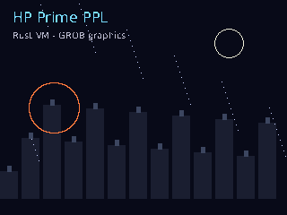

# HP Prime Emulator

[](https://github.com/golba98/hp-prime-emulator/actions/workflows/rust.yml)
[](LICENSE)

A Rust development environment for HP Prime PPL programs, with a native compiler and VM, a graphical editor, and an optional backend that runs the original HP Prime G1 firmware.

Check programs, select an entry function, pass arguments, and run either engine through the same `ppl` CLI. The native engine is the default and needs no calculator or firmware files.



## Two execution engines

| | Native | Original firmware |
|---|---|---|
| Compiler | Rust parser and bytecode compiler | HP's compiler running under ARM emulation |
| Runtime | Rust VM | HP's PPL runtime |
| Interface | CLI and native graphical IDE | Headless CLI |
| Resources | Included source and dependencies | Separately supplied G1 firmware and factory resources |
| Platform | Native platform support depends on desktop and HID libraries | Linux; pinned G1 firmware version |

The firmware backend never falls back to native execution. Missing resources, unsupported arguments, guest faults, and timeouts are reported separately from PPL errors. The graphical IDE currently uses the native engine.

This is an independent project, not an HP product. Compatibility is under active development; neither backend should be assumed to reproduce every calculator feature.

## Get started

Install stable Rust with Cargo. Native builds also need the platform's C/C++ build tools and HID development dependencies; Linux builds use `pkg-config` and `libudev`. The desktop IDE needs a graphical session.

```bash
git clone https://github.com/golba98/hp-prime-emulator.git
cd hp-prime-emulator
cargo build --release --bin ppl

cargo run --release --bin ppl -- check examples/HELLO.ppl
cargo run --release --bin ppl -- run examples/HELLO.ppl
```

Select a function and supply JSON arguments explicitly:

```bash
cargo run --release --bin ppl -- run examples/SQUARE.ppl \
  --engine native --entry SQUARE --args '[7]' --json
```

The returned value is `49`. Existing commands without `--engine` retain their native behavior, including legacy PPL argument syntax. Use `--args-format ppl` when explicitly selecting native mode with PPL-formatted arguments.

Other native tools:

```bash
cargo run --release --bin ppl -- gui examples/FIREWORKS.hpprgm
cargo run --release --bin ppl -- debug examples/HELLO.ppl
cargo run --release --bin ppl -- run examples/FIREWORKS.hpprgm --png output.png
cargo run --release --bin ppl -- --help
```

Source loading supports PPL text and recognized HP Prime program containers. A genuine binary `.hpprgm` container is not treated as plain text merely because of its extension.

The workspace directs Cargo output to `../.cache/prime-emulator-target` to accommodate build tools that cannot handle spaces in the project path. Use Cargo commands or install the binaries rather than assuming `target/release` is inside the repository.

## Original firmware backend

Firmware execution requires Linux, CMake, Clang/libclang, the native build dependencies, and user-supplied firmware assets. Firmware binaries and factory resources are not included or downloaded automatically.

Build both executables:

```bash
scripts/emulator/run.sh build --release --bin ppl --bin prime-emulator
```

Prepare factory resources from your local archive with the existing helper:

```bash
scripts/emulator/prepare_factory_a.sh /path/to/PRIME_APP.DAT /path/to/factory
```

The preparation script requires `mtools`. Configure the resulting resources and the emulator executable:

```bash
export PPL_FIRMWARE=/path/to/armfir.elf
export PPL_OS_ROM=/path/to/PRIME_OS.ROM
export PPL_FACTORY_A=/path/to/factory/A
export PPL_FIRMWARE_RUNNER=/path/to/prime-emulator

cargo run --release --bin ppl -- check examples/HELLO.ppl --engine firmware --json
cargo run --release --bin ppl -- run examples/SQUARE.ppl \
  --engine firmware --entry SQUARE --args '[7]' --json
```

The CLI also accepts explicit resource flags. It discovers the emulator through an explicit path, the configured environment variable, a sibling executable, or `PATH`; it does not launch Cargo behind the scenes.

Each invocation prepares isolated guest storage, imports the program, boots the original firmware, and invokes its compiler. Execution proceeds only after successful compilation. Reports identify the engine and source hash and retain backend-specific evidence. Use `--report` to save JSON and `--png` to request a framebuffer capture; consult command help for timeout and trace options.

Current firmware support includes numeric arguments, recovered PRINT output, supported scalar return values, runtime diagnostics, and guest-generated graphics. Aggregate values and some source locations remain unsupported. A fresh firmware boot takes seconds, unlike an in-process native run. Internal entry points are tied to the documented firmware image.

See the [unified CLI report](docs/emulator/M8_UNIFIED_CLI_REPORT.md) for configuration, result fields, exit codes, measured timings, and reproducible tests. The [compiler](docs/emulator/M6_FIRMWARE_COMPILER_REPORT.md) and [runtime](docs/emulator/M7_FIRMWARE_RUNTIME_REPORT.md) reports distinguish observed firmware behavior from unresolved details.

## Development and testing

```bash
cargo fmt --all -- --check
scripts/emulator/run.sh check --workspace --all-targets
scripts/emulator/run.sh clippy --workspace --all-targets -- -D warnings
scripts/emulator/run.sh test --workspace --all-targets
```

See [Developer scripts](docs/development/SCRIPTS.md) for script architecture,
offline research tools, dependencies, and hardware-isolated validation.

Ordinary tests do not need proprietary firmware. Genuine firmware tests are environment-gated and require local assets; a skipped firmware test is not evidence of guest execution. See the milestone reports for exact environment variables and commands.

The reports include successful native/firmware comparisons and reliability runs, as well as observed timing failures during concurrent traced runs. Rendering, diagnostics, and language semantics can differ between engines.

### Workspace

| Crate | Purpose |
|---|---|
| `ppl-math` | Decimal arithmetic and HP numeric types |
| `ppl-syntax` | Source loading, program containers, lexer, parser, diagnostics |
| `ppl-compiler` | Semantic analysis and native bytecode generation |
| `ppl-vm` | Native execution, values, builtins, host interface |
| `ppl-graphics` | Headless graphics and PNG output |
| `ppl-engine` | Shared results and native/firmware orchestration |
| `prime-emulator` | ARM firmware execution, guest storage, compiler and runtime |
| `ppl-gui` | Native editor, diagnostics, execution and calculator display |
| `ppl-cli` | The `ppl` command |
| `ppl-device` | Optional, explicit USB calculator communication |
| `ppl-compat` | Compatibility suites and evidence reporting |
| `ppl-bench` | Benchmarks |

The superseded Python interpreter has been removed. Its history remains in Git. Small Python helpers used by desktop tests and maintenance remain; they are not an execution backend.

## Documentation

- [Architecture](docs/architecture/overview.md) and [editor design](docs/architecture/editor.md)
- [Native diagnostics](docs/compatibility/diagnostics.md)
- [Firmware research and milestone reports](docs/emulator/README.md)
- [Unified CLI implementation and limitations](docs/emulator/M8_UNIFIED_CLI_REPORT.md)
- [Hardware testing](docs/device/hardware-testing.md)

Physical-device tooling is separate and opt-in. Native and emulated-firmware commands do not require a connected calculator. Read the hardware safety documentation before using USB operations; never use a real calculator as disposable test storage.

## License and acknowledgements

Project source is [MIT licensed](LICENSE). HP firmware is separate proprietary material and is not distributed with this repository. Fonts and third-party dependencies retain their own licenses.

Firmware research references, including the PrimU2 source audit and licensing boundaries, are documented in the [firmware research index](docs/emulator/README.md). Research findings do not imply that third-party code is covered by this project's license.
